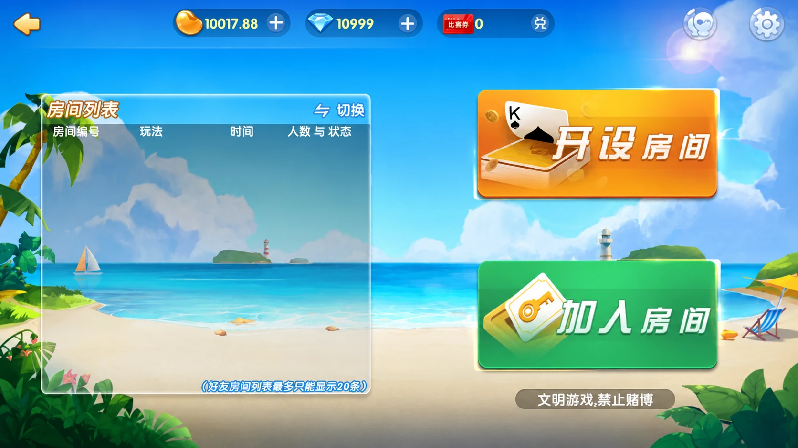
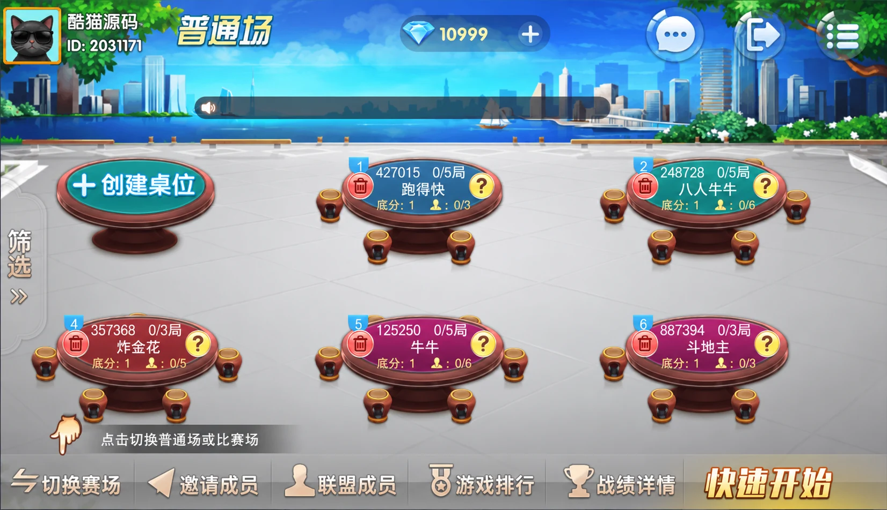
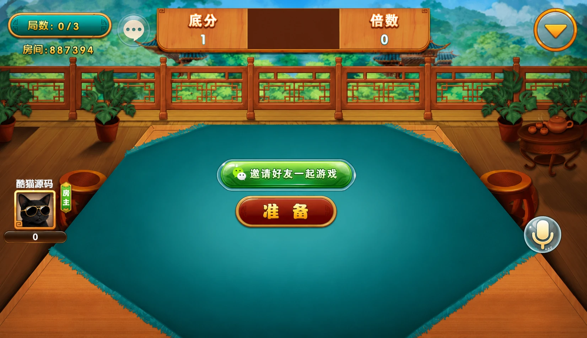

# 牌友联盟第二版：好友房、联盟桌位与列表同步示例

牌友联盟第二版包含好友房、大联盟、金币场和比赛场等入口。玩法涵盖牛牛、金花、斗地主、十三水、跑胡子、跑得快及多种地方麻将。资料列出的推荐环境为PHP、ASP.NET与SQL，并配有搭建视频教程；这里不据此指定各模块的框架版本或数据库型号。

## 好友房

好友房提供开设房间与加入房间两个入口，列表字段包括房间编号、玩法、时间、人数与状态，界面标注最多显示20条记录。空列表仍保留创建和加入入口，便于玩家继续操作。



## 联盟桌位

联盟普通场使用桌位卡片展示不同玩法，卡片包含房号、局数进度和当前人数。桌位列表提供筛选、创建桌位、联盟成员、游戏排行、战绩详情及赛场切换等入口。



不同模式的数据需要分开处理。房卡、金币与比赛券是不同字段，不应在技术介绍中将整个版本说成只有房卡模式；本篇集中讨论房间展示与状态同步，不涉及交易流程或返利配置。

## 斗地主

斗地主准备界面采用中式庭院与绿色牌桌，显示局数、房间号、底分和倍数，提供邀请好友、准备与语音入口。准备状态和已经开始的牌局是不同状态，界面同步时需要保留这一区别。



## 列表同步

房间列表刷新时，旧请求可能比新请求更晚返回。如果收到任何响应都直接替换列表，人数和房间状态就可能倒退。下面的独立教学示例使用服务端递增版本号，只接收同一查询范围内更新的完整快照。

```js
import { createRoomStore } from './room-snapshots.mjs';

const store = createRoomStore('friends');
store.apply({ scope: 'friends', revision: 2, rooms: [
  { id: 'demo-1', game: '斗地主', players: 1, capacity: 3 }
] });

// 迟到的旧快照被忽略，当前列表不变。
store.apply({ scope: 'friends', revision: 1, rooms: [] }); // false
```

[完整示例](room-snapshots.mjs)先检查所有记录，再整体替换数据。重复房号、非法人数或超过容量的记录会使本次更新失败，不会留下只更新一半的列表。一个更新版本的空数组表示列表已经清空，不能将它误判为“无需更新”。

这个模型只适用于完整快照：查询范围由`scope`区分，版本号必须由服务端在该范围内保持单调。分页数据或增量事件不能直接当作完整快照提交；切换筛选条件时应建立对应范围的状态容器。客户端版本比较也不能代替服务端对加入房间的即时校验。

运行 `node test.mjs` 可执行14项断言，覆盖乱序、重复版本、范围隔离、非法记录、数据复制和空列表替换。代码由本仓库独立编写，不是牌友联盟原工程的实现。

## 配图与交流

三张配图为第三方界面整理图，已去除模拟器外框；有账号区域的图片替换了头像和昵称，原有用户ID替换为演示ID，房号保持原样。仓库仅包含文章、配图与独立示例，不包含第三方源码组件或视频附件。

技术交流：[Telegram](https://t.me/root4433)
